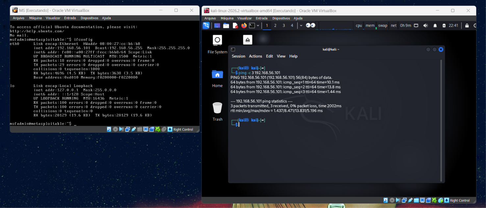

# 🛡️ Authentication Auditing & Brute Force Simulation Lab

[](https://github.com/M0RCEGG0/cybersecurity-bruteforce-medusa)
[](https://dio.me)
[](https://www.kali.org)
[](#-ai-engineering--tooling-ecosystem)
[](https://github.com/M0RCEGG0/cybersecurity-bruteforce-medusa)

---

## 🌐 Language Navigation / Navegação de Idioma
* [English Version (Main Documentation)](#-english-version)
* [Versão em Português (Documentação em Português)](#-versão-em-português)

---

# 🇺🇸 English Version

A hands-on cybersecurity research project simulating authentication auditing, credential recovery, and network service attacks (**Online Brute Force** and **Password Spraying**) against vulnerable targets in an isolated virtual testbed. The project places strong emphasis on offensive execution mechanics, comparative tool analysis, and defensive enterprise hardening.

> ⚠️ **Ethical Disclaimer**: This project was developed strictly for authorized security evaluation and educational purposes within an isolated Host-Only virtualization environment. Unauthorized testing against external systems is illegal and violates international cyber regulations.

---

### 📌 Architecture & Target Environment

The testbed simulates an internal network threat assessment (Internal Pentest scenario) evaluating service exposures, legacy protocols, and default credential vulnerabilities.

* **Auditing Platform (Attacker):** Kali Linux (Medusa v2.2+, THC-Hydra v9.7, Enum4linux)
* **Target Host (Victim):** Metasploitable 2 - IP `192.168.56.101`
* **Network Isolation:** VirtualBox Host-Only Adapter (Private Layer 2 Segment)



---

### 🚀 Executed Scenarios & Attack Vectors

| # | Target Service | Port | Attack Technique | Primary Tool | Discovered Credential | Verification |
| :-: | :--- | :-: | :--- | :--- | :--- | :---: |
| **01** | **FTP (vsftpd)** | 21 / TCP | Multi-user × Multi-password Brute Force | **Medusa** (`ftp.mod`) | `msfadmin:msfadmin` | Verified |
| **02** | **SMB (Samba)** | 445 / TCP | Null Session Enumeration + Password Spraying | **Enum4linux** + **Medusa** (`smbnt.mod`) | `msfadmin:msfadmin` (`ADMIN$`) | `smbclient` Interactive Shell |
| **03** | **Web Application (DVWA)** | 80 / TCP | Dynamic HTTP GET/POST Form Auditing | **THC-Hydra** (`http-get-form`) | `admin:password` | HTTP Response Validation |

Detailed breakdowns, exact command parameters, and terminal logs are available in [docs/01-attack-scenarios.md](docs/01-attack-scenarios.md).

---

### 💡 Core Security Insights

#### 1. Traditional Brute Force vs. Password Spraying
* **Brute Force:** Involves testing large dictionaries against single targets. While effective against unthrottled daemons, it generates immense log volume and rapidly triggers traditional **Account Lockout Policies**.
* **Password Spraying:** The attacker tests a single high-probability password across an enumerated list of corporate identities. Because each individual user incurs only one failed authentication, the attack stays below detection thresholds and **evades standard lockout mechanisms**.

#### 2. Medusa Architectural Scope & Web Form Limitations
* **Medusa** is an ultra-fast, multi-threaded modular cracker built in C for raw network socket daemons (FTP, SSH, Telnet, SMB).
* It is **architecturally unsuitable for modern web application forms** due to session state management (`PHPSESSID`), dynamic anti-CSRF tokens, and complex HTML response parsing. For application-layer auditing, specialized tools like **THC-Hydra** or **Burp Suite** are required.

---

### 🛡️ Enterprise Defense & Blue Team Hardening

Comprehensive mitigations aligned with **NIST CSF**, **CIS Controls v8**, and **PCI-DSS 4.0**:
1. **Network Services (FTP/SMB):** Enforce SFTP migration; configure **Fail2ban** dynamic jails (`maxretry = 3`); disable SMB Anonymous Null Sessions (`restrict anonymous = 2`).
2. **Identity & Access Management (IAM):** Enforce enterprise **Multi-Factor Authentication (MFA)** and **Smart Behavioral Lockout** to neutralize Password Spraying.
3. **Web Applications:** Implement **WAF rate limiting** (5 req/min) and **invisible CAPTCHA challenges**.

Deep-dive architectural mitigation blueprints are documented in [docs/02-defense-mitigation.md](docs/02-defense-mitigation.md).

---

# 🇧🇷 Versão em Português

Projeto prático de cibersegurança focado em auditoria de autenticação, quebra de credenciais e ataques a serviços de rede (**Força Bruta Online** e **Password Spraying**) em ambiente virtual isolado. O projeto dá ênfase tanto à mecânica ofensiva quanto às estratégias corporativas de mitigação e defesa em profundidade (Blue Team).

> ⚠️ **Aviso Ético**: Este projeto foi desenvolvido exclusivamente para fins educacionais e de avaliação autorizada de segurança em ambiente isolado (Host-Only). Testes não autorizados contra sistemas externos são ilegais.

---

### 📌 Arquitetura do Laboratório

O ambiente simula um teste de intrusão em rede interna (Internal Pentest), avaliando serviços vulneráveis e credenciais padrão:

* **Máquina Auditora (Atacante):** Kali Linux (Medusa v2.2+, THC-Hydra v9.7, Enum4linux)
* **Máquina Alvo (Vítima):** Metasploitable 2 - IP `192.168.56.101`
* **Rede:** Adaptador Host-Only no VirtualBox (Segmento Privado Layer 2)

---

### 🚀 Resumo dos Cenários Executados

| # | Serviço Alvo | Porta | Técnica de Ataque | Ferramenta | Credencial Descoberta | Validação |
| :-: | :--- | :-: | :--- | :--- | :--- | :---: |
| **01** | **FTP (vsftpd)** | 21 / TCP | Força Bruta Tradicional (Usuários × Senhas) | **Medusa** (`ftp.mod`) | `msfadmin:msfadmin` | Conexão confirmada |
| **02** | **SMB (Samba)** | 445 / TCP | Enumeração via Sessão Nula + Password Spraying | **Enum4linux** + **Medusa** | `msfadmin:msfadmin` | Shell interativa com `smbclient` |
| **03** | **Web (DVWA)** | 80 / TCP | Força Bruta em Formulário HTTP com Cookies | **THC-Hydra** | `admin:password` | Validação de resposta HTTP |

Documentação completa de cada ataque em: [docs/01-attack-scenarios.md](docs/01-attack-scenarios.md).

---

### 💡 Principais Conceitos Aprendidos

1. **Brute Force vs. Password Spraying:** Enquanto a força bruta testa centenas de senhas em uma única conta (gerando muito ruído e bloqueando a conta), o Password Spraying testa uma única senha comum em centenas de contas, burlando políticas tradicionais de bloqueio.
2. **Limitações do Medusa:** O Medusa é excelente para protocolos de rede puros (FTP, SSH, SMB), mas não gerencia cookies dinâmicos de sessão ou formulários complexos da web, onde ferramentas como o Hydra se mostram essenciais.
3. **Defesa em Profundidade:** Implementação de regras de Fail2ban, desativação de sessões anônimas no SMB (`restrict anonymous = 2`), adoção de MFA obrigatório e regras de detecção em SIEM.

Guia completo de mitigação em: [docs/02-defense-mitigation.md](docs/02-defense-mitigation.md).

---

## 🤖 AI Engineering & Tooling Ecosystem

Este projeto foi concebido e estruturado adotando as práticas mais modernas de **Segurança Aumentada por Inteligência Artificial (AI-Augmented Cybersecurity)**, integrando raciocínio analítico humano e agentes autônomos de IA:

* **Antigravity (Google DeepMind):** Ambiente de desenvolvimento e pair programming com agentes de IA avançados, utilizado para orquestração da metodologia, revisão de integridade de repositório e estruturação de documentação técnica.
* **Gemini 3.8 Flash & Claude Opus 4.6:** Modelos fundacionais de inteligência artificial de última geração utilizados para análise aprofundada de protocolos de rede, formulação de matrizes de risco defensivo e refinamento técnico bilíngue.
* **Security Stack:** Kali Linux, Medusa, THC-Hydra, Enum4linux, Smbclient, Apache2, vsftpd, Samba.
* **Virtualization & Version Control:** Oracle VirtualBox (Host-Only Network), Git, GitHub.

---

## 📂 Estrutura do Repositório / Repository Structure

```text
.
├── docs/
│   ├── 01-attack-scenarios.md     # In-depth technical breakdown of all 3 attack scenarios
│   └── 02-defense-mitigation.md    # Blue Team hardening and enterprise remediation blueprint
├── images/
│   ├── 01-connectivity.png        # Network ping and host verification
│   ├── 02-medusa-ftp-bruteforce.png # Medusa FTP attack execution & success
│   ├── 03-smb-password-spraying.png# SMB enumeration & password spraying success
│   ├── 04-smbclient-access-validation.png # Post-exploitation file share access
│   ├── 05-dvwa-web-form.png        # Web developer tools inspecting form fields
│   └── 06-dvwa-web-bruteforce.png  # Hydra HTTP form attack success
├── wordlists/
│   ├── users.txt                  # Target user dictionary
│   └── passwords.txt              # Password candidate dictionary
├── .gitignore
└── README.md                      # Bilingual project documentation & summary
```

---

## 🎓 Academic & Professional Program

This project was developed as a technical capstone project for the **Bootcamp Santander Cibersegurança 2026**, conducted by **Santander** in partnership with **DIO (Digital Innovation One)**.

---

## 🎓 Programa Acadêmico & Profissional

Projeto desenvolvido como entrega técnica prática do **Bootcamp Santander Cibersegurança 2026**, promovido pelo **Banco Santander** em parceria com a **DIO (Digital Innovation One)**.
